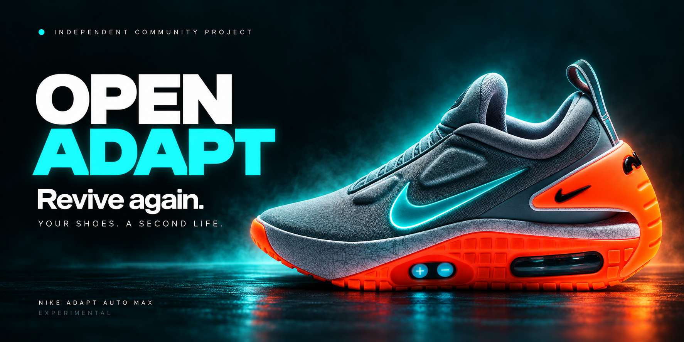
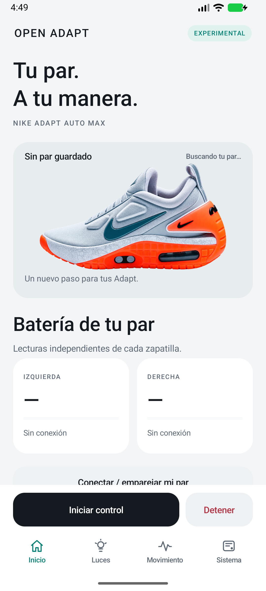
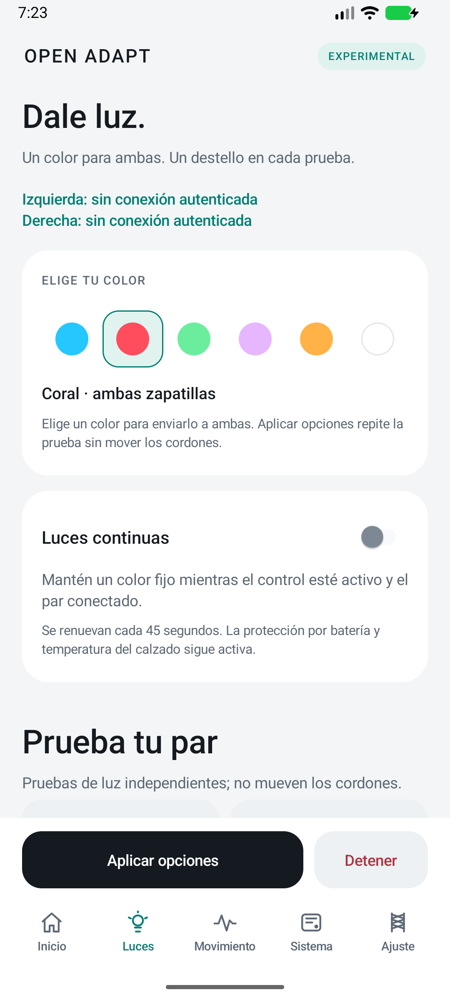

# Nike Adapt Max Revive again

<p align="center">
  
</p>

<div align="center">

**Why nike discontinued this?...**

<sub>Reference-inspired concept artwork: the illuminated Swoosh is an artistic treatment.</sub>

An independent project exploring a second life for Nike Adapt Auto Max.

I own a pair of Adapt. Without the app, I lost access to the connected features I bought them for. Open Adapt began with a simple wish: to use my shoes again.

<a href="https://danielrodrigohub.github.io/open-adapt/downloads/OpenAdapt-v0.3.1.apk"></a>
<a href="output/LEEME.md"></a>
<a href="https://www.paypal.com/donate/?hosted_button_id=TKRBGQY4PJLP6"></a>

**Android 7.0+** &nbsp; / &nbsp; **v0.3.1 experimental** &nbsp; / &nbsp; **Local control**

[Website · English](https://danielrodrigohub.github.io/open-adapt/) · [Sitio · Español](https://danielrodrigohub.github.io/open-adapt/es/)

[Features](#-built-for-a-second-life) · [App preview](#-meet-the-app) · [Install](#-get-moving) · [Validation](output/VALIDACION.md)

</div>

---

## ⚡ Built for a second life

**Your shoes. Your controls.** Open Adapt brings a local control panel to Nike Adapt Auto Max: individual battery percentages, lighting, phone-turn effects and firmware diagnostics.

> [!IMPORTANT]
> This is an **experimental build**. Installation, local onboarding, the battery panel, simulated screen-off turns and stopping the background service have emulator checks. **Bluetooth pairing, live battery readings, lights and motor behavior still need validation on physical Auto Max shoes.**

| Control | What you get |
| --- | --- |
| ✨ **New dashboard** | Four native tabs: Home, Lights, Motion and System. Reference-inspired Auto Max artwork, color swatches, individual battery cards and always-accessible apply/stop actions. |
| 🔓 **Local access** | The new control panel works without Nike registration or login. Some legacy profile screens and Nike links may still depend on Nike services. |
| 🔗 **Reconnection** | Reuses genuinely paired devices and their locally stored keys. A first physical pairing and Android permissions are still required. |
| ⬇️ **GitHub app updates** | Checks public releases on launch (at most once per six hours) or manually. Downloads and verifies the APK in the app, with a trusted project-website fallback; Android confirms installation. Replaces the same signed package, preserving local settings and stored pairing data. See the [update guide](docs/UPDATES.md). |
| 📡 **Nike update checks** | The remote mandatory update check is removed from the local control path. Actual command compatibility checks remain. |
| 🔋 **Battery percentages** | Displays separate left/right percentages from authenticated shoe readings, refreshed about every 20 seconds. Shows connection, waiting and stale-reading states instead of a guessed percentage. |
| 💡 **Continuous lights** | Renews a 60-second solid-color animation every 45 seconds while connected. Custom animations require compatible shoe firmware; the declared minimum is 2.1.7. Hardware battery and thermal cutoffs remain active. |
| 🌙 **Screen-off turns** | A foreground service detects turns using the phone's gyroscope. A phone turn does not identify which foot is striking the ground. |
| 👟 **Foot-strike events** | Receivers exist, but the distributed APK's streaming activation code was stripped. This mode only responds if the shoes are already emitting those events. Activation is not implemented. |
| ⚙️ **Lace movement** | Experimental and off by default. Loosens 1% and returns to the initial position only after confirmation. Limited to five cycles per minute and at least ten seconds between cycles. Physical behavior and audible sound are unverified. |
| 🧬 **Firmware diagnostics** | Reads versions, image states and device-reported checksums, with JSON export. It does not extract a full firmware backup or independently prove firmware integrity. |

## 📱 Meet the app

A fresh native dashboard with reference-inspired artwork, separate battery cards, visual color selection and a persistent stop action.

<table>
<tr>
<td align="center" width="50%"><strong>Control &amp; battery</strong><br /><sub>Lights, motion and battery status in one place.</sub></td>
<td align="center" width="50%"><strong>Light &amp; color</strong><br /><sub>Choose a color and control continuous lighting.</sub></td>
</tr>
<tr>
<td align="center"></td>
<td align="center"></td>
</tr>
</table>

<sub>Actual Android emulator captures. The home artwork was generated with AI from a user-provided Auto Max reference. No physical shoes were connected; the battery cards correctly show missing readings instead of fabricated percentages.</sub>

## 🚀 Get moving

1. [Download OpenAdapt v0.3.1 for Android](https://danielrodrigohub.github.io/open-adapt/downloads/OpenAdapt-v0.3.1.apk). The same signed APK and verification metadata are also listed in [Releases](https://github.com/danielrodrigohub/open-adapt/releases/tag/v0.3.1-experimental).
2. Install it on Android 7.0 or newer. Its package is `com.openadapt.experimental`, so it can coexist with the original Nike Adapt app.
3. Grant Nearby Devices permissions. On older Android versions, location permission and an enabled location service may also be required.
4. Open **Conectar / emparejar mi par** on the Home tab and complete real physical pairing. The new app cannot read the original app's private pairing keys.
5. Return through the Open Adapt icon or notification. Start with the motor option off and test each light before trying movement effects.
6. Select **Luces** for color/continuous lighting or **Movimiento** for effects, then tap **Aplicar opciones**. For phone turns, keep the phone fixed and upright, with its screen facing forward. Start the service before locking the screen.
7. **Detener** is always available above the tab bar; it and the notification's stop action end the session.

See the [Motion](output/interfaz-movimiento.png) and [System](output/interfaz-sistema.png) screens, or the [full Spanish guide](output/LEEME.md) for limitations and the initial motor test procedure. Restart the service after switching to another pair of shoes.

## 🌐 The project website

[English](https://danielrodrigohub.github.io/open-adapt/) · [Español](https://danielrodrigohub.github.io/open-adapt/es/)

A responsive, bilingual GitHub Pages site with the personal story, feature details, real emulator screenshots, installation guidance and PayPal support. Separate crawlable pages include canonical URLs, language alternates, social previews, structured data and a sitemap. See [website maintenance](docs/WEBSITE.md).

## 🧭 Inside the project

| Path | Contents |
| --- | --- |
| `analysis/openadapt/src/com/openadapt/` | New control panel, background service, local storage, protocol bridge and diagnostic parser. |
| `analysis/openadapt/tests/com/openadapt/` | JVM tests for battery display, diagnostics, motor conditions/rate limits and turn detection. |
| `analysis/decoded/` | Apktool-decoded base, including modified smali and resources. |
| `analysis/decompiled/` | JADX inspection output. Decompiled text is not the original application source and may contain incomplete methods. |
| `analysis/offline-originals/`, `analysis/motion-originals/` | Original versions of modified files. |
| `analysis/patch_offline.py`, `analysis/patch_motion.py` | Reproducible modification scripts. |
| `analysis/build_openadapt.py` | Local build, alignment, signing and verification. |
| `analysis/*.proto`, `analysis/*findings*.md` | Packaged protocol definitions and investigation findings. |
| `output/` | Installation guide, validation report, screenshots and published artifact identity. |

APKs are distributed as release assets, with an explicit public download mirror under `site/downloads/` for the current website version. Downloaded third-party tools, private signing keys, passwords, emulator dumps and temporary build outputs are excluded from Git.

## 🛠 For builders

<details>
<summary><strong>Build the APK and run the checks</strong></summary>

Requirements: Python 3, a JDK supporting Java 8 compilation, Android SDK Platform 36 and Build Tools 36.0.0. Set `JAVA_HOME` and `ANDROID_SDK_ROOT` (or `ANDROID_HOME`) if they are not in their usual locations.

Download the pinned Apktool dependency:

```sh
python3 scripts/setup_tools.py
```

For a full reconstruction, download the original Nike Adapt 1.29.3 APK from the [v0.1.0 release assets](https://github.com/danielrodrigohub/open-adapt/releases/tag/v0.1.0-experimental) and place it in the repository root using its original filename. The checked-in decoded tree already contains the modification inputs.

```sh
python3 analysis/build_openadapt.py
```

The build generates its own private signing key under `.signing/`. Keep that key and password private and retain them for your own subsequent updates. A newly generated key differs from the key used for the published APK.

Run the JVM tests:

```sh
python3 scripts/run_tests.py
```

</details>

## ⬇️ Update without starting over

Install this release over your existing experimental app. Future versions can be downloaded from **Sistema → Actualizaciones de la app**, with automatic checks on launch or a manual check. Android asks you to confirm the installation.

The updater checks SHA-256 and requires the same package and signing certificate. It never clears stored pairing keys. **Keep the app installed and keep the same private signing key for future builds.** Real shoe reconnection across an update still needs physical validation.

[How updates work & how to publish the next version →](docs/UPDATES.md)

## 🧪 Tested, with limits

- 44 update-policy assertions cover version ordering, origin restrictions, malformed metadata and downgrade rejection.
- 11 battery-display assertions cover 0–100%, missing readings, disconnected shoes and stale data.
- 43 diagnostic-parser assertions and 32 motor-condition/rate-limit assertions passed, alongside turn-detection scenarios.
- Dashboard navigation and GitHub updates are documented in the [validation report](output/VALIDACION.md); physical shoe reconnection remains unverified.
- Earlier emulator checks covered coexistence with Nike Adapt, the local pairing welcome screen, a simulated turn with the screen locked, and service/wake-lock cleanup after stopping.
- Physical Bluetooth, LEDs, motor response, phone-specific background restrictions and shoe sensor streaming remain to be validated.
- A full, restorable firmware backup is not implemented.

The [validation report](output/VALIDACION.md) records the scope and limits. The motor test code has not been validated on worn shoes; begin with stationary shoes off your feet.

## 🤝 Independent by design

This project is independent and is not affiliated with or endorsed by Nike. Nike trademarks and the original application belong to their respective owners. Decoded and decompiled third-party material retains its original notices and terms; this repository does not relicense that material.

---

<div align="center">

### Keep the project moving.

Research, testing and a second life for Adapt.

<a href="https://www.paypal.com/donate/?hosted_button_id=TKRBGQY4PJLP6"></a>

<sub>Made for the community · Independent from Nike · Experimental by design</sub>

</div>
